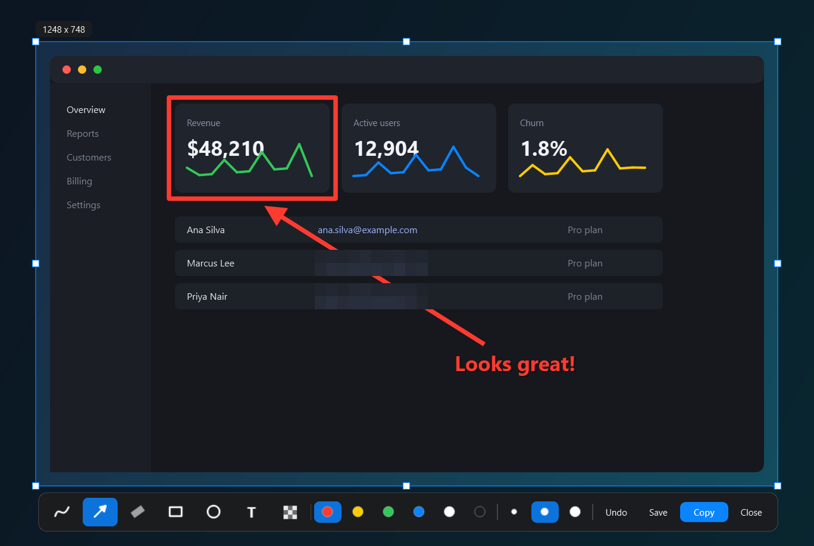

<p align="center">
  
</p>

<h1 align="center">Luma</h1>

**A fast, lightweight screenshot tool for Windows.** Press a key, drag over anything on any monitor, mark it up, and copy or save it. Luma lives in your system tray, starts with Windows, and gets out of the way.

If you are looking for a screenshot app that feels like Lightshot but is built for modern multi-monitor setups, this is it.



## Features

- **Instant capture.** Press `Print Screen` (or `Ctrl+Alt+A`) and the screen freezes in place, exactly as it was.
- **Every monitor, pixel-perfect.** Mixed DPI scaling, rotated and portrait displays are handled correctly.
- **Accurate colors.** Screenshots keep the colors you actually see, including on HDR displays, where most tools produce washed-out or blown-out images.
- **Annotate in place.** Pen, arrow, marker, box, ellipse, text and redact (pixelate sensitive info), with six colors and three sizes.
- **Smart strokes.** Freehand lines are smoothed automatically. Hold still at the end of a stroke and it snaps to a straight line, oval or box.
- **Precise selection.** Move and resize the selection, nudge it with the arrow keys, or double-click to grab the whole monitor.
- **Magnifier and color picker.** Hold `Ctrl` for a pixel-level loupe; press `Ctrl+C` to copy the color under the cursor as hex.
- **Copy or save.** One key to put the image on the clipboard, or save it as a PNG.
- **Make it yours.** A settings window for the capture shortcut, save folder, file name pattern, image format and quality, "ask where to save", editor defaults and more.
- **Quiet tray app.** Starts with Windows, can be quit from the tray menu, and trims its own memory while idle.

## Install

1. Download the latest `Luma-<version>-win64.zip` from the [Releases](../../releases) page.
2. Extract it anywhere and run `Luma.exe`.
3. Luma registers itself to start with Windows on first run. You can turn that off in Settings.

Tested on Windows 11 (64-bit); Windows 10 is expected to work. No installer, no admin rights.

The executable is not code-signed yet, so Windows SmartScreen may warn the first time. Choose **More info**, then **Run anyway**. The full source is in this repository if you prefer to build it yourself.

## Usage

| Action | Shortcut |
| --- | --- |
| Start a capture | `Print Screen` or `Ctrl+Alt+A` |
| Select the whole monitor | Double-click, or `Ctrl+A` |
| Move or resize the selection | Drag inside it, or drag its edges and corners |
| Nudge the selection | Arrow keys (`Shift` for 10 px) |
| Show the magnifier | Hold `Ctrl` while selecting |
| Copy the color under the cursor | `Ctrl+C` while the magnifier is showing |
| Pen / Arrow / Marker / Box / Ellipse / Text / Redact | `P` / `A` / `M` / `B` / `O` / `T` / `R` |
| Copy the image | `Enter` or `Ctrl+C` |
| Save to a file | `Ctrl+S` (to `Pictures\Luma` by default) |
| Undo | `Ctrl+Z` |
| Open the menu (settings, screenshots folder, cancel) | Right-click, or the **Settings** button at the top right |
| Cancel | `Esc` |

The tray icon opens a menu with **Capture**, **Open screenshots folder**, **Settings** and **Quit**.

## Settings

Open them from the tray menu, the right-click menu, or the button at the top right while capturing. Every option applies as soon as you change it.

- **General:** one or two capture shortcuts (Print Screen, letters, digits or F-keys, with Ctrl, Alt, Shift or Win), start with Windows, confirmation toast, help hint.
- **Saving:** save folder (with a folder picker), file name pattern with date and time codes and a live preview, PNG, JPEG or WebP with adjustable quality, an optional "ask where to save every time" prompt, and an option to also save a file whenever you copy.
- **Editor:** starting tool, annotation color and size, background dimming.

## Build from source

```powershell
python -m venv .venv
.venv\Scripts\python -m pip install -r requirements-dev.txt
.venv\Scripts\python luma.py                 # run from source
.venv\Scripts\python build.py                # build dist\Luma\Luma.exe
.venv\Scripts\python build.py --install      # build, install for the current user, add a Start Menu shortcut
```

To change the icon, replace `assets/logo.png` and run `python tools/make_icons.py`.

## How it works

Luma keeps one [DXGI Desktop Duplication](https://learn.microsoft.com/windows/win32/direct3ddxgi/desktop-dup-api) session per monitor, so a capture is a single frame grab instead of a slow screen scrape. HDR frames are converted from scRGB to sRGB against the display's SDR white level, which leaves normal content untouched. The editor is a borderless Qt window per monitor that draws the frozen frame at native resolution.

## Limitations

- Apps that deliberately block screen capture (some games with anti-cheat, protected video) appear black. This is enforced by Windows and the app itself, and applies to every screenshot tool.
- A selection stays on one monitor; it cannot span two.

## License

[MIT](LICENSE)
